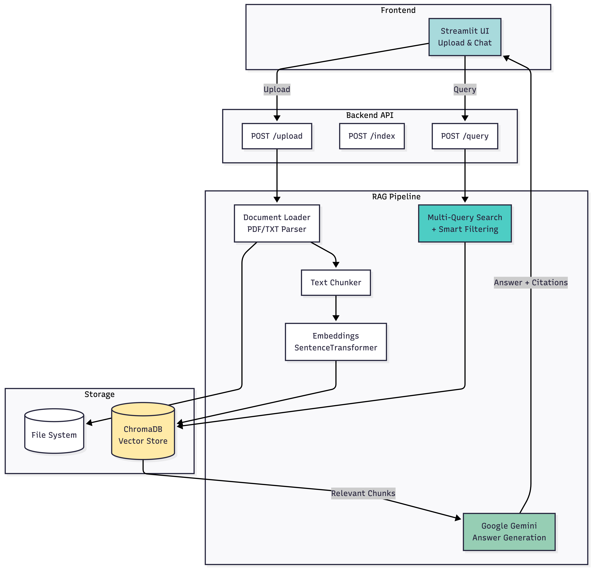

# RAG Studio

A web-based Retrieval-Augmented Generation (RAG) system that allows users to upload documents, ask questions, and receive answers grounded explicitly in retrieved source content.

---

## Architecture



---

## What is RAG Studio?

RAG Studio demonstrates the core RAG pipeline:

1. Upload PDF or TXT documents
2. Index documents using semantic embeddings
3. Query documents with natural language questions
4. Generate answers grounded in retrieved document chunks
5. Attribute answers by showing the exact source chunks used

The system emphasizes source transparency by always showing which document chunks were used to generate each answer.

---

## Features

- Multi-Query Retrieval - Automatically rewrites queries in multiple ways for better document matching
- Smart Similarity Filtering - Only applies threshold when more than 5 documents indexed
- Strict Document Grounding - Answers are generated only when relevant document context exists
- Multi-document Support - Upload and manage multiple documents
- Document Management - Delete documents and their embeddings
- Source Attribution - Shows which documents were used for each answer
- Semantic Search - ChromaDB vector database for retrieval
- Answer Generation - Google Gemini for grounded responses
- Clean UI - Streamlit chat interface with left-right layout

### Multi-Query Vector Search

The system improves retrieval by:
1. Query Analysis - LLM analyzes user intent
2. Query Rewriting - Generates 2-3 alternative phrasings
3. Multi-Vector Search - Searches with all query variations
4. Result Aggregation - Deduplicates and ranks by best scores
5. Quality Boost - Documents matching multiple queries rank higher

### Grounding Enforcement

The system will not answer questions if no relevant context is found (when more than 5 documents are indexed).

When you ask a question:
1. System rewrites your query into multiple perspectives
2. Searches uploaded documents with all variations
3. If more than 5 documents: Applies similarity threshold filtering (0.5)
4. If 5 or fewer documents: Returns all matches (no threshold)
5. If no relevant content found (when threshold applies), it explicitly says so
6. LLM is only called when relevant context exists
7. All answers include source attribution

---

## System Components

**Backend (FastAPI):**
- `/upload` - Accept and store document files
- `/index` - Extract text, chunk, embed, and store in vector database
- `/query` - Retrieve relevant chunks and generate grounded answers
- `/documents` - List all indexed documents
- `/documents/{filename}` - Delete a document and its embeddings

**Components:**
- SentenceTransformers for embeddings (local model)
- ChromaDB for vector storage (persistent)
- Google Gemini for answer generation
- Streamlit frontend with chat interface

---

## Setup Instructions

### Prerequisites

- Python 3.8 or higher
- Google Gemini API key - Get one at https://aistudio.google.com/api-keys

### Installation

1. Clone the repository:
```bash
git clone https://github.com/nkmohit/rag-studio.git
cd rag-studio
```

2. Install dependencies:
```bash
pip install -r requirements.txt
```

3. Download the embedding model:
```bash
python download_model.py
```
This will download the sentence-transformers model to `./utils/models/retriever/`

4. Create environment file:
```bash
echo "GEMINI_API_KEY=your_api_key_here" > .env
```
Replace `your_api_key_here` with your actual Gemini API key.

### Running the Application

1. Start the backend server:
```bash
uvicorn main:app --reload
```
Backend will run on http://localhost:8000

2. In a separate terminal, start the Streamlit UI:
```bash
streamlit run streamlit_app.py
```
UI will open automatically in your browser at http://localhost:8501

### Usage

1. Upload Documents - Click "Upload New Document" and select PDF or TXT files
2. Manage Documents - View all indexed documents in the left panel
3. Ask Questions - Type questions in the chat interface
4. View Sources - See which documents and chunks were used for each answer

---

## Design Principles

1. Multi-Query Retrieval - Rewrite queries for comprehensive document coverage
2. Strict Grounding - Never answer without relevant document context
3. Similarity Filtering - Only retrieve chunks above threshold
4. Source Attribution - Always show which documents were used
5. Clear Separation of Concerns - Loader, embeddings, generation are independent
6. Explicit Over Implicit - Clear error messages when context is missing
7. No Hallucination - LLM instructed to answer only from provided context

---

## License

MIT License - See [LICENSE](LICENSE) file for details.  
